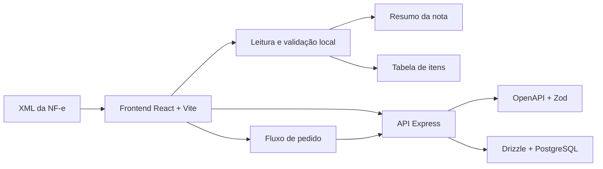

<div align="center">
  
  <h1>Confere Notas Fiscais</h1>
  <p>Confira a NF-e do fornecedor antes de guardar a mercadoria.</p>

  <p>
    <a href="#-visão-geral">Visão geral</a> ·
    <a href="#-funcionalidades">Funcionalidades</a> ·
    <a href="#-como-executar">Como executar</a> ·
    <a href="#-arquitetura">Arquitetura</a>
  </p>

  <p>
    
    
    
    
  </p>
</div>

<br />

<p align="center">
  
</p>

## ✨ Visão geral

O **Confere Notas Fiscais** transforma o XML da NF-e em uma conferência rápida e legível. A aplicação destaca emitente, número, data, quantidade de itens, preços e totais para ajudar a comparar o documento com a mercadoria recebida.

> **Privacidade por padrão:** a leitura do XML começa no próprio navegador. O arquivo não precisa ser enviado para um serviço externo para a conferência básica.

## 🚀 Funcionalidades

- **Leitura de XML:** arraste o arquivo ou selecione uma NF-e no computador.
- **Resumo da nota:** emitente, número, data de emissão e quantidade de itens.
- **Tabela de itens:** descrição, quantidade, unidade, preço unitário e total.
- **Conferência de pedido:** fluxo dedicado para organizar itens e comparar informações.
- **Sugestões e mensagens:** endpoints preparados para apoiar o preenchimento e a comunicação do pedido.
- **Feedback de estados:** carregamento, erro de arquivo, substituição e remoção sem recarregar a página.
- **Acessibilidade:** foco visível, regiões semânticas, mensagens `aria-live` e tabela navegável horizontalmente.

<details>
<summary><strong>🧭 Fluxo principal</strong></summary>

1. Obtenha o XML da NF-e no e-mail do fornecedor ou no portal da Sefaz.
2. Abra o arquivo no Confere usando a área de arrastar e soltar.
3. Revise os dados do emitente e os itens apresentados.
4. Use os fluxos de pedido e conferência quando precisar comparar ou registrar divergências.

</details>

## 🧩 Arquitetura



| Camada | Tecnologias | Responsabilidade |
| --- | --- | --- |
| Interface | React, TypeScript, Wouter, Tailwind CSS | Upload, navegação e conferência visual |
| Dados locais | Parser de XML + contexto React | Normalização dos dados da NF-e no navegador |
| API | Express 5, OpenAPI, Zod | Endpoints de pedido e sugestões |
| Persistência | PostgreSQL, Drizzle ORM | Dados do domínio quando o fluxo exigir armazenamento |
| Workspace | pnpm, TypeScript, Vite | Gerenciamento do monorepo, build e validação |

<details>
<summary><strong>📁 Mapa do repositório</strong></summary>

```text
artifacts/
├── confere/          # Aplicação principal React/Vite
├── api-server/       # API Express
└── mockup-sandbox/   # Sandbox para prévias de componentes
lib/
├── api-client-react/ # Hooks/clientes gerados para a API
├── api-spec/         # Contrato OpenAPI
├── api-zod/          # Schemas e validações
├── db/               # Drizzle e schema do banco
└── integrations-*/   # Integrações do workspace
scripts/              # Rotinas auxiliares do monorepo
```

</details>

## 🛠️ Como executar

### Pré-requisitos

- Node.js 24+
- pnpm 10+
- PostgreSQL, caso execute os fluxos que usam persistência

### Instalação

```bash
git clone https://github.com/nicolasletti/Confere-Notas-Fiscais.git
cd Confere-Notas-Fiscais
pnpm install
```

### Desenvolvimento

```bash
# Frontend
pnpm --filter @workspace/confere run dev

# API
pnpm --filter @workspace/api-server run dev
```

A aplicação frontend ficará disponível no endereço informado pelo Vite, normalmente `http://localhost:5173`.

### Validação e build

```bash
pnpm run typecheck
pnpm run build
```

<details>
<summary><strong>⚙️ Variáveis de ambiente</strong></summary>

Para os fluxos que acessam o banco, configure `DATABASE_URL` com a string de conexão do PostgreSQL. A leitura básica do XML pode ser explorada no frontend sem essa variável.

</details>

## 📌 Rotas da aplicação

| Rota | Uso |
| --- | --- |
| `/` | Upload e leitura da NF-e |
| `/pedido` | Organização de itens e pedido |
| `/conferencia` | Conferência e comparação das informações |

## 🤝 Contribuindo

1. Crie uma branch: `git checkout -b feat/minha-melhoria`
2. Faça a alteração mantendo os tipos e os contratos da API atualizados.
3. Rode `pnpm run typecheck` e `pnpm run build`.
4. Abra um pull request descrevendo o problema e a solução.

## 📄 Licença

Distribuído sob a licença MIT. Consulte o arquivo `package.json` para os metadados do projeto.

<p align="center">
  Feito para tornar a conferência de recebimento mais simples e confiável.
</p>
